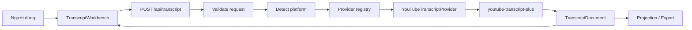

# ClipRead — Kiến trúc hệ thống

## 1. Phạm vi domain

ClipRead tập trung vào bounded context **Video → Nội dung có thể đọc**. Core không phải downloader; media chỉ xuất hiện nếu sau này cần pipeline speech-to-text.

Từ vựng thống nhất: `Source URL`, `Platform`, `TranscriptProvider`, `TranscriptDocument`, `TranscriptSegment`, `ReadableParagraph` và `Export`.

## 2. Luồng hiện tại



Khi chưa cấu hình worker, TikTok và Facebook kết thúc bằng `PROVIDER_NOT_READY`. Khi có worker, TikTok/Facebook đi qua `yt-dlp` adapter; YouTube vẫn ưu tiên provider caption hiện tại và chỉ chuyển worker khi thiếu caption. Nếu thiếu caption, worker chuyển sang Whisper local.

## 3. Ranh giới module

### `app/`

Chứa entry point của Next.js: page, layout và route HTTP. Route chịu trách nhiệm protocol HTTP, status code và ghép các module; không nên chứa thuật toán làm sạch transcript.

### `components/`

Chứa UI và interaction ở browser. UI được phép gọi API, quản lý loading/error và gọi các hàm projection/export thuần; không được import thư viện provider.

### `domain/`

Chứa contract không phụ thuộc Next.js: kiểu document, nhận diện URL, làm sạch segment, grouping paragraph, format SRT/Markdown/TXT và kiểu lỗi API.

### `services/`

Chứa interface provider, registry và adapter kết nối upstream. Adapter biến shape của upstream thành `TranscriptDocument`.

### `worker/`

Worker được tách theo trách nhiệm để không biến HTTP entry point thành một module monolith:

- `server.py`: HTTP endpoint, auth và điều phối job.
- `job_store.py`: SQLite-backed job store, giới hạn queue, TTL cleanup và recovery sau restart.
- `captions.py`: chọn caption, tải caption an toàn và chuẩn hóa VTT/SRT/TTML/JSON.
- `transcriber.py`: subprocess `yt-dlp`/FFmpeg và model Whisper cache theo process.
- `metrics.py`, `rate_limiter.py`: metrics tối thiểu và giới hạn submit theo client.
- `platforms.py`, `errors.py`: allowlist nền tảng và lỗi nội bộ dùng chung.

Chạy từ root repository bằng `python3 -m worker.server` để các import module hoạt động nhất quán giữa local và test.

## 4. Vì sao seam provider tồn tại?

UI chỉ biết `TranscriptDocument`, còn provider chỉ cần thỏa `supports()` và `getTranscript()`. Đây là seam thực tế vì YouTube đã là một adapter và TikTok/Facebook có thể trở thành adapter khác. Không tạo thêm abstraction cho database, AI hoặc worker trước khi có implementation thứ hai.

## 5. Contract dữ liệu hiện tại

```ts
interface TranscriptSegment {
  text: string;
  duration: number;
  offset: number;
  lang?: string;
}

interface TranscriptDocument {
  sourceUrl: string;
  platform: 'youtube' | 'tiktok' | 'facebook' | 'unknown';
  title: string;
  author?: string;
  durationSeconds?: number;
  language?: string;
  thumbnail?: string;
  segments: TranscriptSegment[];
}
```

Thời gian hiện dùng đơn vị giây vì đó là shape adapter YouTube đang trả về. Không đổi thành `startMs`/`durationMs` nếu chưa có lý do và migration rõ ràng.

## 6. Speech-to-text trong tương lai

Không chạy yt-dlp, FFmpeg hoặc Whisper trong request ngắn của Vercel. Khi cần fallback:

```text
Web/API → tạo job → queue → worker → lấy audio tạm
       → normalize → STT → TranscriptDocument → lưu kết quả tạm → client
```

Worker cần timeout, retry, cancellation, cleanup, giới hạn tài nguyên và idempotency riêng.

Các phần timeout, retry giới hạn, cleanup, idempotency URL/ngôn ngữ và SQLite persistence hiện đã có ở mức local MVP; cancellation hiện dừng polling phía client, không hủy process Whisper đang chạy.

Worker hiện đã có SQLite job state, recovery sau restart, rate limit submit và một job mỗi lần, cùng `yt-dlp`, FFmpeg và Whisper local. Đây vẫn là lựa chọn tiết kiệm chi phí cho máy cá nhân; chưa phải hệ thống production auto-scale nhiều worker.

## 7. Nguyên tắc không phá kiến trúc

- Transcript gốc là source of truth.
- Projection đọc và output export không được sửa segment gốc.
- Không gọi provider từ React.
- Không đưa raw exception hoặc shape upstream ra client.
- Không gọi platform là “được hỗ trợ” nếu chưa có test matrix lặp lại.
- Không thêm layer chỉ vì tên thư mục nghe có vẻ chuẩn hơn.
